# Katalogen: alt spillet er laget av

Laget av `python3 -m tools.qa catalog` fra dataene (se `tools/qa/catalog.py`); rett i `assets/catalog/*.json`, ikke her. Eierens dom står i `assets/catalog/approvals.json` og settes bare av eieren.

## Oversikt

- **Teksturer:** 82, 67 består teksturkontrollen (P-T), 27 har bare et malt bilde og er ikke tatt i bruk som lag.
- **Modeller:** 127 i spillet: 99 godkjent, 0 underkjent, 28 ikke vurdert. 1 står ikke noe sted.
- **Ventes:** 32 modeller systemene venter på (fiender, figurer, våpen, dyr …).
- **Forbilder:** 115 bilder, 34 brukt av et oppsett i sheet2model.
- **Glb-filer som ikke er i bruk:** arms/arms.glb, arms/arms_leather.glb, arms/arms_mail.glb, arms/axe.glb, arms/dagger.glb, arms/shield_round.glb, arms/shield_tower.glb, arms/sword.glb, crypt/kit_rest_flame.glb, furniture/altar.glb, furniture/apothecary_counter.glb, furniture/apothecary_shelf.glb, furniture/baptismal_font.glb, furniture/barrel_bars.glb, furniture/barrel_home.glb, furniture/barrel_lying.glb, furniture/barrel_rack.glb, furniture/barrel_tall.glb, furniture/bed_0.glb, furniture/bed_1.glb, furniture/bed_2.glb, furniture/bed_3.glb, furniture/bed_apothecary.glb, furniture/bed_chest.glb, furniture/bed_home.glb, furniture/bench_16.glb, furniture/bench_20.glb, furniture/bookcase_lab.glb, furniture/bookshelf_a.glb, furniture/bookshelf_b.glb, furniture/bookshelf_e.glb, furniture/bookshelf_gallery_0.glb, furniture/bookshelf_gallery_1.glb, furniture/bookshelf_w.glb, furniture/candle.glb, furniture/candle_stand.glb, furniture/candle_stand_low.glb, furniture/cellar_crate.glb, furniture/cellar_shelf.glb, furniture/chain_lantern_forge.glb, furniture/chained_book.glb, furniture/chandelier_large.glb, furniture/chandelier_small.glb, furniture/chest_forms.glb, furniture/chest_home.glb, furniture/church_wall_bench.glb, furniture/coal_pail.glb, furniture/crock_shelf.glb, furniture/door_shelf_jars.glb, furniture/drying_bed_back.glb, furniture/drying_bed_front.glb, furniture/drying_rack_0.glb, furniture/drying_rack_1.glb, furniture/firewood_small.glb, furniture/firewood_stack.glb, furniture/forge_crate.glb, furniture/forge_weapon_rack.glb, furniture/forge_workbench.glb, furniture/ham_hanging.glb, furniture/hanging_lantern.glb, furniture/helmet_shelf.glb, furniture/herb_basket_0.glb, furniture/herb_basket_1.glb, furniture/herb_basket_2.glb, furniture/herb_sacks.glb, furniture/home_table.glb, furniture/iron_bars_leaning.glb, furniture/jar_shelf.glb, furniture/jug_shelf.glb, furniture/kitchen_table.glb, furniture/lab_bench.glb, furniture/lab_shelf.glb, furniture/lab_table.glb, furniture/mantel_crocks.glb, furniture/plate_rail.glb, furniture/rug_rag.glb, furniture/sacks.glb, furniture/sacks_two.glb, furniture/scroll_chest.glb, furniture/stool.glb, furniture/table_18.glb, furniture/table_22.glb, furniture/tavern_counter.glb, furniture/tavern_tapestry.glb, furniture/tool_wall.glb, furniture/wash_stand.glb, furniture/writing_desk_0.glb, furniture/writing_desk_1.glb, furniture/writing_desk_2.glb, furniture/writing_desk_gallery.glb, furniture/writing_desk_unlit.glb, mobs/accordion_coffin.glb, mobs/avatar_skull.glb, mobs/breadcrumb_crawler.glb, mobs/datepicker_priest.glb, mobs/mutant_button.glb, mobs/mutant_input.glb, mobs/mutant_modal.glb, mobs/mutant_select.glb, mobs/mutant_table.glb, mobs/mutant_toast.glb, mobs/mutant_tooltip.glb.

## Ventes (skal lages)

| Modell | Hva |
|---|---|
| `mutant_button` | fiende (fase 5) |
| `mutant_tooltip` | fiende (fase 5) |
| `mutant_input` | fiende (fase 5) |
| `mutant_modal` | fiende (fase 5) |
| `mutant_table` | fiende (fase 5) |
| `framework` | sluttbossen Rammeverket (fase 5) |
| `token` | tokenene fiendene mister (fase 7) |
| `key` | nøkkelen eliten mister (fase 7) |
| `bolt` | spyttet fra inputen (fase 5) |
| `arms` | armene i førsteperson (fase 7) |
| `sword` | våpen (fase 7) |
| `axe` | våpen (fase 7) |
| `dagger` | våpen (fase 7) |
| `shield_round` | skjold (fase 7) |
| `shield_tower` | skjold (fase 7) |
| `sheep_body` | sau (fase 7) |
| `sheep_leg` | sau (fase 7) |
| `cow_body` | ku (fase 7) |
| `cow_leg_front` | ku (fase 7) |
| `cow_leg_hind` | ku (fase 7) |
| `npc_smith` | figur (fase 5) |
| `npc_clerk` | figur (fase 5) |
| `npc_apothecary` | figur (fase 5) |
| `npc_innkeeper` | figur (fase 5) |
| `npc_gorvek` | figur (fase 5) |
| `npc_farmer` | figur (fase 5) |
| `npc_maid` | figur (fase 5) |
| `npc_guard` | figur (fase 5) |
| `npc_merchant` | figur (fase 5) |
| `npc_fishwife` | figur (fase 5) |
| `npc_boy` | figur (fase 5) |
| `npc_washerwoman` | figur (fase 5) |

## Teksturer

P-T: kilden stor nok, uten ramme og med jevnt lys; laget flisbart og skarpt (`tools/qa/texture.py`). Arkene (dører, list, skilt, vinduer) sjekkes bare for størrelse og skarphet. Perspektiv vurderes med øyet.

### Byen

| Bilde | Lag | Viser | Brukt av | P-T | Eierens dom |
|---|---|---|---|---|---|
| 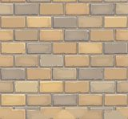 | `ashlar` (flis) | Hogde sandsteinsblokker i forband, beige og grå, lyse fuger. | `house_d`, `house_k`, `house_m`, `house_s`, `scriptorium` | ok | **godkjent** (2026-10-11):  |
| 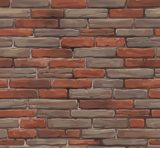 | `chimney` (flis) | Murt pipe av rød og grå tegl. | `house_a`, `house_b`, `house_c`, `house_d`, `house_e`, `house_f` og 19 til | ok | **godkjent** (2026-10-11):  |
| 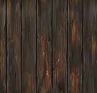 | `church_boards` (flis) | Tjærebredde, mørke stående bord (stavkirka). | ingen modell | ok | **godkjent** (2026-10-11):  |
| 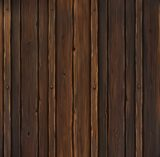 | `cladding` (flis) | Stående brune bord med fuger (kledning). | `house_a`, `house_b`, `house_c`, `house_d`, `house_e`, `house_f` og 19 til | ok | **godkjent** (2026-10-11):  |
| 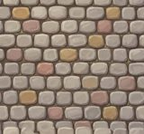 | `cobble` (flis) | Brostein, avrundede steiner i varme og grå farger. | ingen modell | ok | **underkjent** (2026-10-11): dårlig horisontal skjøt |
| 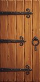 | `door` (ark) | Én dør: brune stående bord med smijernshengsler og ring. | `house_a`, `house_b`, `house_c`, `house_d`, `house_f`, `house_g` og 12 til | ok | **godkjent** (2026-10-11):  |
| 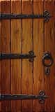 | `door_b` (ark) | Én dør, variant: rødbrune bord med hengsler og ring. | `house_e`, `house_i`, `house_j`, `house_m`, `house_p`, `house_r` og 10 til | ok | **godkjent** (2026-10-11):  |
| 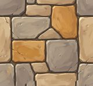 | `flagstone` (flis) | Store kantete heller i varme og grå toner. | `town_wall`, `wall_tower`, `gatehouse`, `lantern_post`, `well`, `portal_ring` og 4 til | ok | **godkjent** (2026-10-11):  |
| 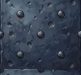 | `iron` (flis) | Blåsvart smijern med naglehoder. | `house_a`, `house_b`, `house_c`, `house_d`, `house_e`, `house_f` og 60 til | feil: lys 0.57 | **godkjent** (2026-10-11):  |
| 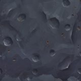 | `iron_worked` (flis) (bare malt, ikke lag) | Hamret mørkt jern med bulker. | ingen modell | ok | **godkjent** (2026-10-11):  |
| 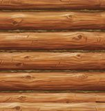 | `logs` (flis) | Liggende tømmerstokker med mose i fugene (laft). | `house_c`, `house_o`, `shed_b`, `woodpile`, `forge`, `tavern_interior` og 2 til | ok | **godkjent** (2026-10-11):  |
| 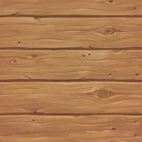 | `oak_planed` (flis) | Høvlede lyse eikebord (gulv og møbler). | `forge`, `tavern`, `home` | feil: skarphet 1.34 | **godkjent** (2026-10-11):  |
| 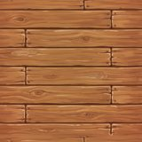 | `planks` (flis) | Liggende rødbrune bord med spikre. | `coop`, `picket_fence`, `forge`, `tavern_interior`, `home`, `home_interior` og 9 til | ok | **godkjent** (2026-10-11):  |
| 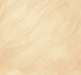 | `plaster` (flis) | Varm, lys kalkpuss. | `house_a`, `house_b`, `house_c`, `house_d`, `house_e`, `house_f` og 36 til | ok | **godkjent** (2026-10-11):  |
| 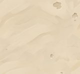 | `plaster_old` (flis) | Lys puss med avskallinger. | `house_f`, `house_l`, `house_t`, `forge`, `crypt_01_ao`, `kit_down` og 2 til | feil: megapiksler 1.79, skarphet 1.34 | **godkjent** (2026-10-11):  |
| 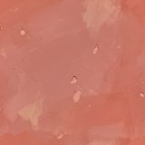 | `plaster_red` (flis) | Rød puss med avskallinger. | `house_d`, `house_k`, `house_p`, `forge`, `home`, `apothecary` | feil: megapiksler 1.54 | **underkjent** (2026-10-11): flekke blir gjentagende så det er støyende på avstand. for mange små flekker mener jeg |
|  | `plaster_white` (flis) | Hvit puss. | `house_b`, `house_g`, `house_i`, `house_m`, `house_r`, `home` og 10 til | feil: megapiksler 1.79, skarphet 1.27 | **godkjent** (2026-10-11):  |
| 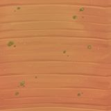 | `pottery` (flis) (bare malt, ikke lag) | Oransje brent leire med glasurflekker (krukker). | ingen modell | ok | **godkjent** (2026-10-11):  |
| 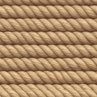 | `rope` (flis) (bare malt, ikke lag) | Snodd tau, liggende rader. | ingen modell | ok | **godkjent** (2026-10-11):  |
| 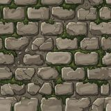 | `ruin` (flis) | Gammel, mosegrodd steinmur. | `portal_ring`, `stave_church`, `crypt` | ok | **godkjent** (2026-10-11):  |
| 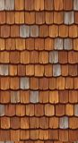 | `shingles` (flis) | Spon, rødbrune og grå trespon (tak). | `house_g`, `house_j`, `house_q`, `house_t`, `wall_tower`, `gatehouse` og 4 til | ok | **godkjent** (2026-10-11):  |
| 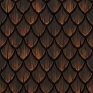 | `shingles_tar` (flis) | Tjærebredt, rundet spon i skjell (stavkirketaket). | `house_m` | feil: megapiksler 1.00, skjøt 1.31 | **godkjent** (2026-10-11):  |
| 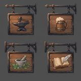 | `signs` (ark) (bare malt, ikke lag) | Fire hengeskilt: ambolt, ølkrus, morter, bok og fjær. | ingen modell | ok | **godkjent** (2026-10-11):  |
| 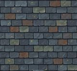 | `slate` (flis) | Skifer, blågrå med enkelte røde og grønne. | `house_b`, `house_e`, `house_k`, `house_p`, `apothecary`, `scriptorium` og 2 til | ok | **godkjent** (2026-10-11):  |
| 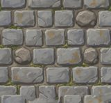 | `stone` (flis) | Grå kvadersteinsmur med runde steiner og mose. | `house_a`, `house_b`, `house_c`, `house_d`, `house_e`, `house_f` og 30 til | feil: skjøt 1.04 | **underkjent** (2026-10-11): skjøten er for dårlig |
| 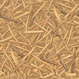 | `straw` (flis) (bare malt, ikke lag) | Løs halm, lys. | ingen modell | ok | **godkjent** (2026-10-11):  |
| 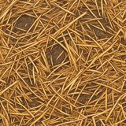 | `straw_floor` (flis) | Halm strødd på et mørkt gulv. | `haystack`, `market_stall_b` | ok | **godkjent** (2026-10-11):  |
| 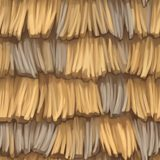 | `thatch` (flis) | Halmtak i lag. | `house_a`, `house_f`, `house_h`, `house_l`, `house_o`, `house_r` og 5 til | feil: megapiksler 1.05, skjøt 1.50 | **godkjent** (2026-10-11):  |
| 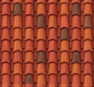 | `tiles` (flis) | Røde munk-og-nonne-takstein. | `house_d`, `house_i`, `house_n`, `house_s`, `forge` | ok | **godkjent** (2026-10-11):  |
| 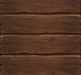 | `timber` (flis) | Mørkbrunt tømmer, liggende bjelker. | `house_a`, `house_b`, `house_c`, `house_d`, `house_e`, `house_h` og 59 til | ok | **godkjent** (2026-10-11):  |
| 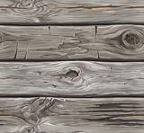 | `timber_grey` (flis) | Gråvær, sprukket tømmer. | `house_f`, `house_g`, `house_n`, `house_p`, `house_t`, `shed_a` og 13 til | ok | **godkjent** (2026-10-11):  |
| 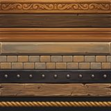 | `trim` (ark) | Trim-ark: utskåret list, profiler, tegl, nagleband, tau. | `house_a`, `house_b`, `house_c`, `house_d`, `house_e`, `house_f` og 33 til | ok | **godkjent** (2026-10-11):  |
| 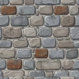 | `wall_stone` (flis) | Kløyvd naturstein i blå, grå og rustrøde toner. | `town_wall`, `wall_tower`, `gatehouse`, `lantern_post`, `well`, `signpost` og 8 til | ok | **godkjent** (2026-10-11):  |
| 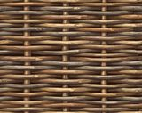 | `wattle` (flis) | Flettverk av kvister mellom stolper. | `garden`, `wattle_fence`, `rail_fence`, `forge` | ok | **godkjent** (2026-10-11):  |
| 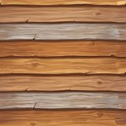 | `weatherboard` (flis) | Liggende kledningsbord, brune og grå. | `shed_a`, `shed_b`, `coop`, `wall_tower`, `gatehouse`, `market_stall` og 9 til | ok | **godkjent** (2026-10-11):  |
| 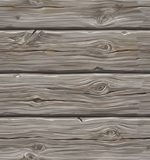 | `weatherboard_grey` (flis) | Liggende gråværede kledningsbord. | `house_e`, `shed_a`, `shed_b`, `privy`, `coop` | ok | **godkjent** (2026-10-11):  |
| 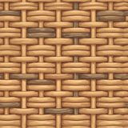 | `wicker` (flis) (bare malt, ikke lag) | Flettet kurv. | ingen modell | ok | **godkjent** (2026-10-11):  |
| 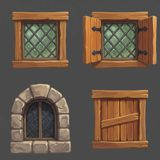 | `windows` (ark) (bare malt, ikke lag) | Fire vinduer: blyglass med karm, med skodder, rundbuet i stein, gjenspikret. | ingen modell | ok | **godkjent** (2026-10-11):  |

### Naturen

| Bilde | Lag | Viser | Brukt av | P-T | Eierens dom |
|---|---|---|---|---|---|
| 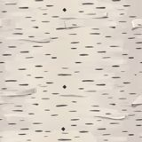 | `bark_birch` (flis) (bare malt, ikke lag) | Hvit bjørkebark med svarte streker. | ingen modell | ok | **godkjent** (2026-10-11):  |
| 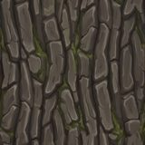 | `bark_oak` (flis) (bare malt, ikke lag) | Grov, mørk eikebark med mose i sprekkene. | ingen modell | ok | **godkjent** (2026-10-11):  |
| 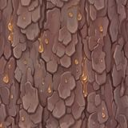 | `bark_spruce` (flis) (bare malt, ikke lag) | Rødbrun granbark i flak med harpiksdråper. | ingen modell | ok | **godkjent** (2026-10-11):  |
| 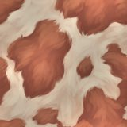 | `cow_fur` (flis) (bare malt, ikke lag) | Rødbrun og hvit kuskinn i flekker. | ingen modell | feil: lys 0.18 | **godkjent** (2026-10-11):  |
| 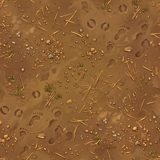 | `earth` (flis) | Brun, tråkket jord med småstein og fotspor. | `garden` | ok | **godkjent** (2026-10-11):  |
| 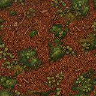 | `forest_floor` (flis) | Barnåler, kongler og mose (skogbunn). | ingen modell | ok | **godkjent** (2026-10-11):  |
| 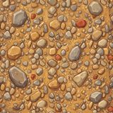 | `gravel` (flis) | Grus og småstein på gul jord. | ingen modell | ok | **godkjent** (2026-10-11):  |
| 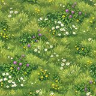 | `meadow` (flis) | Gress med hvite, gule og lilla blomster (eng). | ingen modell | ok | **godkjent** (2026-10-11):  |
| 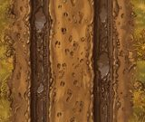 | `mud` (flis) | Søle med hjulspor og gress i kantene (veiene). | ingen modell | feil: megapiksler 0.88, skjøt 2.26 | **usikker** (2026-10-11): mange hjulspor skal det være? blir overgangen mot omkringliggende teksturer for hard? |
| 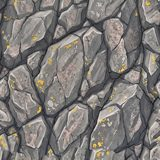 | `rock` (flis) | Grått berg med lav. | `forge` | ok | **godkjent** (2026-10-11):  |
| 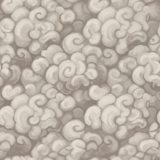 | `sheep_wool` (flis) (bare malt, ikke lag) | Krøllet saueull. | ingen modell | ok | **godkjent** (2026-10-11):  |
| 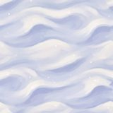 | `snow` (flis) | Snø i myke driver. | ingen modell | feil: skjøt 1.21, skarphet 1.22 | **godkjent** (2026-10-11):  |
| 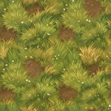 | `sod` (flis) | Torv, gresstuster og jord (torvtak). | `house_c`, `garden`, `home`, `apothecary`, `apothecary_interior`, `stave_church` og 1 til | ok | **godkjent** (2026-10-11):  |

### Figurer og utstyr

| Bilde | Lag | Viser | Brukt av | P-T | Eierens dom |
|---|---|---|---|---|---|
|  | `chainmail` (flis) | Ringbrynje, tett flettede jernringer. | ingen modell | ok | **godkjent** (2026-10-11):  |
|  | `felt` (flis) | Brun filt. | ingen modell | ok | **godkjent** (2026-10-11):  |
|  | `fur` (flis) | Grå pels i lokker. | ingen modell | feil: skarphet 1.38 | **godkjent** (2026-10-11):  |
|  | `gambeson` (flis) | Kremhvit vattert kjortel i ruter. | ingen modell | ok | **godkjent** (2026-10-11):  |
|  | `leather` (flis) | Brunt lær med sømmer. | `apothecary`, `scriptorium`, `crypt`, `kit_lore` | feil: skarphet 1.38 | **godkjent** (2026-10-11):  |
|  | `linen` (flis) | Hvitt lin, fin vev. | `market_stall`, `market_stall_b`, `cart`, `lantern_post`, `training_dummy`, `scriptorium` og 1 til | ok | **godkjent** (2026-10-11):  |
|  | `parchment` (flis) (bare malt, ikke lag) | Lyst pergament med flekker. | ingen modell | ok | **godkjent** (2026-10-11):  |
|  | `plate_steel` (flis) (bare malt, ikke lag) | Hamret stålplate. | ingen modell | ok | **godkjent** (2026-10-11):  |
|  | `weave` (flis) (bare malt, ikke lag) | Grov vev i fiskebein. | ingen modell | ok | **godkjent** (2026-10-11):  |
|  | `wool` (flis) | Grå ullvev. | `market_stall_b`, `forge`, `home_interior` | feil: skjøt 1.67 | **godkjent** (2026-10-11):  |

### Krypten: gravkjelleren

| Bilde | Lag | Viser | Brukt av | P-T | Eierens dom |
|---|---|---|---|---|---|
|  | `bronze_door` (flis) | Mørke eikeplanker med jernbånd og nagler (kryptdører). | `kit_shortcut_leaf`, `kit_up` | ok | **godkjent** (2026-10-11):  |
|  | `crypt_floor` (flis) | Uregelmessige grå steinheller (kryptgulv). | `crypt_01_aa`, `crypt_01_ab`, `crypt_01_ac`, `crypt_01_ad`, `crypt_01_ae`, `crypt_01_af` og 21 til | ok | **godkjent** (2026-10-11):  |
|  | `crypt_plaster` (flis) | Hvit puss med stjerner og prikker og murhull. Underkjent som «barnerom». | ingen modell | ok | **underkjent** (2026-10-11): Stjernetapetet får krypten til å se ut som et barnerom; laget bruker plaster_old til ny kryptpuss kommer. |
|  | `crypt_vault` (flis) | Mørk, smal tegl i hvelv (kryptens tak). | ingen modell | ok | **godkjent** (2026-10-11):  |
|  | `crypt_wall` (flis) | Lyse kvadersteiner i forband (kryptens vegger). | `crypt_01_aa`, `crypt_01_ab`, `crypt_01_ac`, `crypt_01_ad`, `crypt_01_ae`, `crypt_01_af` og 30 til | ok | **godkjent** (2026-10-13):  |
|  | `glitch_seam` (flis) | Mørk stein med lysende cyan og rosa sprekker og pikselblokker (de korrupte sømmene). | `crypt_01_aa` | feil: skarphet 1.34 | **godkjent** (2026-10-11):  |
|  | `grave_slab` (flis) | Gravheller med kors og skjold i et steingulv. | `crypt_01_aa`, `crypt_01_ab`, `crypt_01_ad`, `crypt_01_ai`, `crypt_01_aj`, `crypt_01_ak` og 17 til | ok | **godkjent** (2026-10-11):  |
|  | `ossuary` (flis) | Hodeskaller og knokler stablet (beinhuset). | `crypt_01_ai`, `crypt_01_aj`, `crypt_01_ak`, `crypt_01_aq`, `crypt_01_ar`, `crypt_01_av` og 3 til | ok | **godkjent** (2026-10-11):  |
|  | `rubble` (flis) | Steinur, løse steiner og grus. | `crypt_01_ac`, `crypt_01_al` | ok | **godkjent** (2026-10-11):  |

### Krypten: kloakken

| Bilde | Lag | Viser | Brukt av | P-T | Eierens dom |
|---|---|---|---|---|---|
|  | `sewer_brick` (flis) (bare malt, ikke lag) | Mørk, fuktig tegl (kloakken). | ingen modell | ok | **godkjent** (2026-10-11):  |
|  | `sewer_floor` (flis) (bare malt, ikke lag) | Våte steinheller med pytter og mose (kloakken). | ingen modell | ok | **godkjent** (2026-10-11):  |
|  | `water_murky` (flis) (bare malt, ikke lag) | Grumsete grønt vann med ringer. | ingen modell | ok | **godkjent** (2026-10-11):  |

### Krypten: gruva

| Bilde | Lag | Viser | Brukt av | P-T | Eierens dom |
|---|---|---|---|---|---|
|  | `cave_rock` (flis) (bare malt, ikke lag) | Lagdelt blågrå berg, skrått sjiktet (huler). | ingen modell | ok | **godkjent** (2026-10-11):  |
|  | `crystal` (flis) (bare malt, ikke lag) | Blå krystaller i klaser. | ingen modell | ok | **godkjent** (2026-10-11):  |
|  | `mine_rock` (flis) (bare malt, ikke lag) | Mørk, kantet berg (gruva). | ingen modell | ok | **godkjent** (2026-10-11):  |
|  | `mine_timber` (flis) (bare malt, ikke lag) | Grå, slitte bjelker (gruvas avstivning). | ingen modell | ok | **godkjent** (2026-10-11):  |

### Krypten: borgen

| Bilde | Lag | Viser | Brukt av | P-T | Eierens dom |
|---|---|---|---|---|---|
|  | `keep_ashlar` (flis) (bare malt, ikke lag) | Mørk kvaderstein (borgen). | ingen modell | ok | **godkjent** (2026-10-11):  |
|  | `keep_floor` (flis) (bare malt, ikke lag) | Rutete gulv av grå og røde steinfliser på skrå (borgen). | ingen modell | ok | **godkjent** (2026-10-11):  |

### Krypten: den korrupte kjernen

| Bilde | Lag | Viser | Brukt av | P-T | Eierens dom |
|---|---|---|---|---|---|
|  | `core_plastic` (flis) (bare malt, ikke lag) | Grå plastaktige plater med bolter og flekker (den korrupte kjernen). | ingen modell | ok | **godkjent** (2026-10-11):  |
|  | `core_stone` (flis) (bare malt, ikke lag) | Mørk stein med lysende cyan og fiolette fuger (den korrupte kjernen). | ingen modell | ok | **underkjent** (2026-10-11): vertikal skjøt ser ikke bra ut, dette må det tenker nytt om |
|  | `rust` (flis) (bare malt, ikke lag) | Grått metall med rustflekker. | ingen modell | ok | **godkjent** (2026-10-11):  |

## Modeller

### crypt

| Bilde | Navn (fil) | Hva | Står ute | Trekanter | Mål (m) | Teksturlag | Eierens dom |
|---|---|---|---|---|---|---|---|
|  | `crypt_01_aa` (crypt/crypt_01_aa.glb) | Bit av kryptnivå 1  Gravkjelleren under kirka (16 × 16 m). | 1× | 1 842 | 13.7 × 6.8 × 8.2 | crypt_floor  crypt_wall  glitch_seam  grave_slab  iron … | **godkjent** (2026-10-13):  |
|  | `crypt_01_ab` (crypt/crypt_01_ab.glb) | Bit av kryptnivå 1  Gravkjelleren under kirka (16 × 16 m). | 1× | 2 386 | 18.2 × 14.8 × 19.1 | crypt_floor  crypt_wall  grave_slab | **usikker** (2026-10-13): Er det huller i hjørnet rundt de greiene i hvert hjørne? |
|  | `crypt_01_ac` (crypt/crypt_01_ac.glb) | Bit av kryptnivå 1  Gravkjelleren under kirka (16 × 16 m). | 1× | 1 221 | 15.7 × 14.5 × 11.2 | crypt_floor  crypt_wall  iron  rubble  timber | **usikker** (2026-10-13): Usikker på om det er tett eller om man kan se ut sprekker |
|  | `crypt_01_ad` (crypt/crypt_01_ad.glb) | Bit av kryptnivå 1  Gravkjelleren under kirka (16 × 16 m). | 1× | 1 956 | 20.5 × 14.4 × 11.7 | crypt_floor  crypt_wall  grave_slab | **usikker** (2026-10-13): Usikker på om det er tett eller om man kan se ut sprekker |
|  | `crypt_01_ae` (crypt/crypt_01_ae.glb) | Bit av kryptnivå 1  Gravkjelleren under kirka (16 × 16 m). | 1× | 747 | 18.0 × 11.5 × 16.5 | crypt_floor  crypt_wall | **usikker** (2026-10-13): Usikker på om det er tett eller om man kan se ut sprekker |
|  | `crypt_01_af` (crypt/crypt_01_af.glb) | Bit av kryptnivå 1  Gravkjelleren under kirka (16 × 16 m). | 1× | 618 | 18.5 × 4.8 × 2.0 | crypt_floor  crypt_wall | **usikker** (2026-10-13): Det er umulig å vurdere så store deler på så små bilder. Jeg må kunne zoome og rotere ellers kan jeg ikke være sikker |
|  | `crypt_01_ag` (crypt/crypt_01_ag.glb) | Bit av kryptnivå 1  Gravkjelleren under kirka (16 × 16 m). | 1× | 1 499 | 13.7 × 7.2 × 10.2 | crypt_floor  crypt_wall  timber | **usikker** (2026-10-13): Det er umulig å vurdere så store deler på så små bilder. Jeg må kunne zoome og rotere ellers kan jeg ikke være sikker |
|  | `crypt_01_ah` (crypt/crypt_01_ah.glb) | Bit av kryptnivå 1  Gravkjelleren under kirka (16 × 16 m). | 1× | 366 | 12.4 × 7.0 × 2.2 | crypt_floor  crypt_wall  timber | **usikker** (2026-10-13): Det er umulig å vurdere så store deler på så små bilder. Jeg må kunne zoome og rotere ellers kan jeg ikke være sikker |
|  | `crypt_01_ai` (crypt/crypt_01_ai.glb) | Bit av kryptnivå 1  Gravkjelleren under kirka (16 × 16 m). | 1× | 2 540 | 10.4 × 8.2 × 16.2 | crypt_floor  crypt_wall  grave_slab  iron  ossuary … | **usikker** (2026-10-13): Det er umulig å vurdere så store deler på så små bilder. Jeg må kunne zoome og rotere ellers kan jeg ikke være sikker |
|  | `crypt_01_aj` (crypt/crypt_01_aj.glb) | Bit av kryptnivå 1  Gravkjelleren under kirka (16 × 16 m). | 1× | 2 594 | 12.6 × 6.5 × 28.0 | crypt_floor  crypt_wall  grave_slab  ossuary | **usikker** (2026-10-13): Det er umulig å vurdere så store deler på så små bilder. Jeg må kunne zoome og rotere ellers kan jeg ikke være sikker |
|  | `crypt_01_ak` (crypt/crypt_01_ak.glb) | Bit av kryptnivå 1  Gravkjelleren under kirka (16 × 16 m). | 1× | 2 788 | 17.0 × 8.2 × 23.1 | crypt_floor  crypt_wall  grave_slab  iron  ossuary … | **usikker** (2026-10-13): Det er umulig å vurdere så store deler på så små bilder. Jeg må kunne zoome og rotere ellers kan jeg ikke være sikker   Tror det er huller |
|  | `crypt_01_al` (crypt/crypt_01_al.glb) | Bit av kryptnivå 1  Gravkjelleren under kirka (16 × 16 m). | 1× | 2 588 | 17.0 × 9.2 × 16.5 | crypt_floor  crypt_wall  grave_slab  iron  rubble … | **usikker** (2026-10-13): Det er umulig å vurdere så store deler på så små bilder. Jeg må kunne zoome og rotere ellers kan jeg ikke være sikker . Stopper søyler midt i luften? |
|  | `crypt_01_am` (crypt/crypt_01_am.glb) | Bit av kryptnivå 1  Gravkjelleren under kirka (16 × 16 m). | 1× | 3 263 | 14.6 × 11.4 × 34.0 | crypt_wall  grave_slab  iron  timber | **usikker** (2026-10-13): Det er umulig å vurdere så store deler på så små bilder. Jeg må kunne zoome og rotere ellers kan jeg ikke være sikker |
|  | `crypt_01_an` (crypt/crypt_01_an.glb) | Bit av kryptnivå 1  Gravkjelleren under kirka (16 × 16 m). | 1× | 2 755 | 15.2 × 10.2 × 19.5 | crypt_floor  crypt_wall  grave_slab  iron  timber | **usikker** (2026-10-13): Det er umulig å vurdere så store deler på så små bilder. Jeg må kunne zoome og rotere ellers kan jeg ikke være sikker |
|  | `crypt_01_ao` (crypt/crypt_01_ao.glb) | Bit av kryptnivå 1  Gravkjelleren under kirka (16 × 16 m). | 1× | 2 451 | 15.2 × 10.2 × 20.0 | crypt_floor  crypt_wall  grave_slab  iron  plaster_old … | **usikker** (2026-10-13): Det er umulig å vurdere så store deler på så små bilder. Jeg må kunne zoome og rotere ellers kan jeg ikke være sikker |
|  | `crypt_01_ap` (crypt/crypt_01_ap.glb) | Bit av kryptnivå 1  Gravkjelleren under kirka (16 × 16 m). | 1× | 367 | 7.4 × 5.3 × 2.2 | crypt_floor  crypt_wall | **usikker** (2026-10-13):  |
|  | `crypt_01_aq` (crypt/crypt_01_aq.glb) | Bit av kryptnivå 1  Gravkjelleren under kirka (16 × 16 m). | 1× | 1 410 | 17.2 × 12.0 × 7.8 | crypt_floor  crypt_wall  grave_slab  iron  ossuary … | **usikker** (2026-10-13):  |
|  | `crypt_01_ar` (crypt/crypt_01_ar.glb) | Bit av kryptnivå 1  Gravkjelleren under kirka (16 × 16 m). | 1× | 1 739 | 17.2 × 12.2 × 16.4 | crypt_floor  crypt_wall  grave_slab  iron  ossuary … | **usikker** (2026-10-13):  |
|  | `crypt_01_as` (crypt/crypt_01_as.glb) | Bit av kryptnivå 1  Gravkjelleren under kirka (16 × 16 m). | 1× | 714 | 1.7 × 4.0 × 17.2 | crypt_floor  crypt_wall | **usikker** (2026-10-13):  |
|  | `crypt_01_at` (crypt/crypt_01_at.glb) | Bit av kryptnivå 1  Gravkjelleren under kirka (16 × 16 m). | 1× | 715 | 16.3 × 10.5 × 32.4 | crypt_floor  crypt_wall  iron  timber | **usikker** (2026-10-13):  |
|  | `crypt_01_au` (crypt/crypt_01_au.glb) | Bit av kryptnivå 1  Gravkjelleren under kirka (16 × 16 m). | 1× | 2 302 | 21.5 × 11.2 × 13.2 | crypt_floor  crypt_wall  iron  timber | **usikker** (2026-10-13):  |
|  | `crypt_01_av` (crypt/crypt_01_av.glb) | Bit av kryptnivå 1  Gravkjelleren under kirka (16 × 16 m). | 1× | 3 094 | 17.9 × 13.7 × 11.1 | crypt_floor  crypt_wall  grave_slab  iron  ossuary … | **usikker** (2026-10-13):  |
|  | `crypt_01_aw` (crypt/crypt_01_aw.glb) | Bit av kryptnivå 1  Gravkjelleren under kirka (16 × 16 m). | 1× | 4 374 | 17.2 × 13.9 × 16.6 | crypt_floor  crypt_wall  grave_slab  iron  ossuary … | **usikker** (2026-10-13):  |
|  | `crypt_01_ax` (crypt/crypt_01_ax.glb) | Bit av kryptnivå 1  Gravkjelleren under kirka (16 × 16 m). | 1× | 1 143 | 9.3 × 4.0 × 17.1 | crypt_floor  crypt_wall | **usikker** (2026-10-13):  |
|  | `crypt_01_ay` (crypt/crypt_01_ay.glb) | Bit av kryptnivå 1  Gravkjelleren under kirka (16 × 16 m). | 1× | 480 | 1.1 × 3.6 × 32.4 | crypt_floor  crypt_wall | **usikker** (2026-10-13):  |
|  | `crypt_01_az` (crypt/crypt_01_az.glb) | Bit av kryptnivå 1  Gravkjelleren under kirka (16 × 16 m). | 1× | 801 | 4.8 × 9.2 × 11.2 | crypt_floor  crypt_wall  iron  timber | **usikker** (2026-10-13): Det er umulig å vurdere så store deler på så små bilder. Jeg må kunne zoome og rotere ellers kan jeg ikke være sikker |
|  | `crypt_01_ba` (crypt/crypt_01_ba.glb) | Bit av kryptnivå 1  Gravkjelleren under kirka (16 × 16 m). | 1× | 477 | 3.9 × 11.7 × 7.4 | crypt_floor  crypt_wall  grave_slab  iron  ossuary … | **usikker** (2026-10-13): Det er umulig å vurdere så store deler på så små bilder. Jeg må kunne zoome og rotere ellers kan jeg ikke være sikker |
|  | `crypt_01_bb` (crypt/crypt_01_bb.glb) | Bit av kryptnivå 1  Gravkjelleren under kirka (16 × 16 m). | 1× | 633 | 3.4 × 11.7 × 7.6 | crypt_floor  crypt_wall  grave_slab  iron  ossuary … | **usikker** (2026-10-13): Det er umulig å vurdere så store deler på så små bilder. Jeg må kunne zoome og rotere ellers kan jeg ikke være sikker |
|  | `kit_arrow` (crypt/kit_arrow.glb) | Pil fra pilfella. | posert av spillet | 28 | 0.1 × 0.1 × 0.7 | door_b  iron  plaster_white | **godkjent** (2026-10-11):  |
|  | `kit_bonus` (crypt/kit_bonus.glb) | Relikvieskrin (varig styrke): eikeskrin med forgylt saltak  kors og glødende steiner  på en steinsokkel. | 1× | 108 | 0.6 × 1.3 × 0.6 | crypt_wall  grave_slab  planks  plaster_white | **godkjent** (2026-10-12):  |
|  | `kit_crack` (crypt/kit_crack.glb) | Sprekk i muren (hint om en hemmelighet). | 1× | 54 | 0.8 × 1.7 × 0.2 | crypt_wall | **godkjent** (2026-10-12):  |
|  | `kit_down` (crypt/kit_down.glb) | Trappa ned til neste nivå  med blått lys. | 1× | 450 | 4.0 × 7.1 × 4.5 | crypt_wall  grave_slab  plaster_old | **godkjent** (2026-10-13):  |
|  | `kit_gate` (crypt/kit_gate.glb) | Portgitteret. | posert av spillet | 156 | 2.8 × 3.0 × 0.1 | iron | **godkjent** (2026-10-11):  |
|  | `kit_ladder` (crypt/kit_ladder.glb) | Stige av bjelker (en bit på 1 m som stables). | 1× | 48 | 0.6 × 1.0 × 0.1 | timber | **godkjent** (2026-10-12):  |
|  | `kit_lever` (crypt/kit_lever.glb) | Spakens sokkel av hogd stein med jernkinn og aksel. | 1× | 30 | 0.6 × 0.6 × 0.5 | crypt_wall  grave_slab  iron | **godkjent** (2026-10-12):  |
|  | `kit_lever_arm` (crypt/kit_lever_arm.glb) | Spakens arm. | posert av spillet | 42 | 0.1 × 1.0 × 0.1 | iron  timber | **usikker** (2026-10-13):  |
|  | `kit_lore` (crypt/kit_lore.glb) | Lesepult av tre med en åpen bok og et lys (lore). | 1× | 72 | 0.8 × 1.2 × 0.5 | iron  leather  planks  plaster_white  timber | **godkjent** (2026-10-12):  |
|  | `kit_plate` (crypt/kit_plate.glb) | Trykkplate. | 1× | 10 | 1.0 × 0.2 × 1.0 | grave_slab | **godkjent** (2026-10-11):  |
|  | `kit_rest` (crypt/kit_rest.glb) | Hvilestedet: alter med lysestake. | 1× | 1 520 | 0.6 × 1.7 × 0.6 | bakt tekstur | **godkjent** (2026-10-12):  |
|  | `kit_sarcophagus` (crypt/kit_sarcophagus.glb) | Sarkofag av hogd stein med blinde rundbuer og et kors i relieff på lokket. | 13× | 196 | 1.0 × 1.1 × 2.1 | crypt_wall  grave_slab | **godkjent** (2026-10-12):  |
|  | `kit_secret_wall` (crypt/kit_secret_wall.glb) | Falsk vegg: én hel murbit med en tydelig sprekk  som synker i gulvet. | posert av spillet | 36 | 2.0 × 2.6 × 0.6 | crypt_wall | **godkjent** (2026-10-13):  |
|  | `kit_shortcut` (crypt/kit_shortcut.glb) | Snarveidørens karm: vangestein og kilesteiner som følger buen  på begge sider av muren. | 1× | 170 | 2.2 × 2.6 × 0.7 | crypt_wall  grave_slab  plaster_old | **godkjent** (2026-10-12):  |
|  | `kit_shortcut_leaf` (crypt/kit_shortcut_leaf.glb) | Snarveidørens blad med slå i to U-kramper. | posert av spillet | 122 | 1.6 × 2.3 × 0.3 | bronze_door  iron  planks  timber | **godkjent** (2026-10-12):  |
|  | `kit_trapdoor` (crypt/kit_trapdoor.glb) | Fallem av planker med hengselbånd og jernring. | posert av spillet | 34 | 1.2 × 0.1 × 1.2 | iron  planks  trim | **godkjent** (2026-10-12):  |
|  | `kit_up` (crypt/kit_up.glb) | Døra opp til nivået over. | 1× | 358 | 2.2 × 3.2 × 1.0 | bronze_door  crypt_wall  grave_slab  planks  plaster_old | **godkjent** (2026-10-12):  |

### town

| Bilde | Navn (fil) | Hva | Står ute | Trekanter | Mål (m) | Teksturlag | Eierens dom |
|---|---|---|---|---|---|---|---|
|  | `house_a` (town/house_a.glb) | Vanlig hus fra byggesettet (byen eller bondegårdene). | 1× | 8 796 | 8.2 × 15.2 × 10.8 | chimney  cladding  door  iron  plaster … | **godkjent** (2026-10-12):  |
|  | `house_b` (town/house_b.glb) | Vanlig hus fra byggesettet (byen eller bondegårdene). | 1× | 8 716 | 10.8 × 13.4 × 9.6 | chimney  cladding  door  iron  plaster … | **godkjent** (2026-10-12):  |
|  | `house_c` (town/house_c.glb) | Vanlig hus fra byggesettet (byen eller bondegårdene). | 1× | 5 552 | 8.8 × 8.8 × 9.1 | chimney  cladding  door  iron  logs … | **godkjent** (2026-10-12):  |
|  | `house_d` (town/house_d.glb) | Vanlig hus fra byggesettet (byen eller bondegårdene). | 1× | 10 624 | 8.2 × 19.3 × 11.8 | ashlar  chimney  cladding  door  iron … | **godkjent** (2026-10-12):  |
|  | `house_e` (town/house_e.glb) | Vanlig hus fra byggesettet (byen eller bondegårdene). | 1× | 4 848 | 11.4 × 12.6 × 9.0 | chimney  cladding  door_b  iron  plaster … | **godkjent** (2026-10-12):  |
|  | `house_f` (town/house_f.glb) | Vanlig hus fra byggesettet (byen eller bondegårdene). | 1× | 9 020 | 9.1 × 15.1 × 11.0 | chimney  cladding  door  iron  plaster … | **godkjent** (2026-10-12):  |
|  | `house_g` (town/house_g.glb) | Vanlig hus fra byggesettet (byen eller bondegårdene). | 1× | 8 300 | 7.5 × 15.6 × 10.4 | chimney  cladding  door  iron  plaster … | **godkjent** (2026-10-12):  |
|  | `house_h` (town/house_h.glb) | Vanlig hus fra byggesettet (byen eller bondegårdene). | 1× | 5 108 | 10.0 × 10.0 × 8.6 | chimney  cladding  door  iron  plaster … | **godkjent** (2026-10-13):  |
|  | `house_i` (town/house_i.glb) | Vanlig hus fra byggesettet (byen eller bondegårdene). | 1× | 9 020 | 9.4 × 14.1 × 10.8 | chimney  cladding  door_b  iron  plaster … | **godkjent** (2026-10-12):  |
|  | `house_j` (town/house_j.glb) | Vanlig hus fra byggesettet (byen eller bondegårdene). | 1× | 3 416 | 7.8 × 9.1 × 8.4 | chimney  cladding  door_b  iron  plaster … | **godkjent** (2026-10-13):  |
|  | `house_k` (town/house_k.glb) | Vanlig hus fra byggesettet (byen eller bondegårdene). | 1× | 8 432 | 11.8 × 13.4 × 10.1 | ashlar  chimney  cladding  door  iron … | **godkjent** (2026-10-13):  |
|  | `house_l` (town/house_l.glb) | Vanlig hus fra byggesettet (byen eller bondegårdene). | 1× | 12 304 | 8.7 × 20.2 × 12.6 | chimney  cladding  door  iron  plaster … | **godkjent** (2026-10-12):  |
|  | `house_m` (town/house_m.glb) | Vanlig hus fra byggesettet (byen eller bondegårdene). | 1× | 6 588 | 9.2 × 13.3 × 9.4 | ashlar  chimney  cladding  door_b  iron … | **godkjent** (2026-10-12):  |
|  | `house_n` (town/house_n.glb) | Vanlig hus fra byggesettet (byen eller bondegårdene). | 1× | 9 508 | 10.6 × 14.0 × 10.0 | chimney  cladding  door  iron  plaster … | **godkjent** (2026-10-12):  |
|  | `house_o` (town/house_o.glb) | Vanlig hus fra byggesettet (byen eller bondegårdene). | 1× | 5 048 | 7.6 × 9.2 × 8.2 | chimney  cladding  door  iron  logs … | **godkjent** (2026-10-13):  |
|  | `house_p` (town/house_p.glb) | Vanlig hus fra byggesettet (byen eller bondegårdene). | 1× | 8 844 | 8.4 × 15.5 × 11.3 | chimney  cladding  door_b  iron  plaster … | **godkjent** (2026-10-12):  |
|  | `house_q` (town/house_q.glb) | Vanlig hus fra byggesettet (byen eller bondegårdene). | 1× | 4 704 | 11.0 × 12.4 × 9.0 | chimney  cladding  door  iron  plaster … | **godkjent** (2026-10-12):  |
|  | `house_r` (town/house_r.glb) | Vanlig hus fra byggesettet (byen eller bondegårdene). | 1× | 8 436 | 8.8 × 14.6 × 10.6 | chimney  cladding  door_b  iron  plaster … | **godkjent** (2026-10-12):  |
|  | `house_s` (town/house_s.glb) | Vanlig hus fra byggesettet (byen eller bondegårdene). | 1× | 10 608 | 8.1 × 20.0 × 12.0 | ashlar  chimney  cladding  door_b  iron … | **godkjent** (2026-10-12):  |
|  | `house_t` (town/house_t.glb) | Vanlig hus fra byggesettet (byen eller bondegårdene). | 2× | 4 892 | 9.8 × 9.7 × 8.6 | chimney  cladding  door_b  iron  plaster … | **godkjent** (2026-10-13):  |
|  | `shed_a` (town/shed_a.glb) | Uthus. | 7× | 372 | 3.9 × 3.7 × 3.3 | door_b  stone  timber_grey  trim  weatherboard … | **godkjent** (2026-10-12):  |
|  | `shed_b` (town/shed_b.glb) | Uthus  variant. | 7× | 4 188 | 4.3 × 3.6 × 2.7 | logs  stone  timber_grey  weatherboard  weatherboard_grey | **godkjent** (2026-10-12):  |
|  | `privy` (town/privy.glb) | Utedo. | 9× | 288 | 1.7 × 3.4 × 1.7 | cladding  door  stone  trim  weatherboard_grey | **godkjent** (2026-10-12):  |
|  | `haystack` (town/haystack.glb) | Høystakk (bondegårdene). | 7× | 446 | 3.4 × 4.1 × 3.0 | straw_floor  timber_grey | **godkjent** (2026-10-12):  |
|  | `garden` (town/garden.glb) | Kjøkkenhage med gjerde. | 6× | 1 440 | 4.1 × 1.6 × 3.1 | earth  sod  timber_grey  wattle | **godkjent** (2026-10-12):  |
|  | `coop` (town/coop.glb) | Hønsehus (bondegårdene). | 8× | 316 | 2.2 × 2.7 × 2.6 | planks  timber_grey  weatherboard  weatherboard_grey | **godkjent** (2026-10-12):  |
|  | `town_wall` (town/town_wall.glb) | Bymuren  en bit. | 46× | 1 522 | 6.2 × 8.5 × 2.5 | flagstone  stone  wall_stone | **godkjent** (2026-10-11):  |
|  | `wall_tower` (town/wall_tower.glb) | Tårn i bymuren. | 10× | 4 518 | 9.4 × 20.8 × 9.4 | flagstone  iron  shingles  stone  timber … | **godkjent** (2026-10-11):  |
|  | `gatehouse` (town/gatehouse.glb) | Porthuset der Storgata møter bymuren. | 2× | 9 678 | 14.9 × 19.1 × 7.1 | door_b  flagstone  iron  shingles  stone … | **godkjent** (2026-10-12):  |
|  | `market_cross` (town/market_cross.glb) | Torgkorset. | 1× | 982 | 2.4 × 4.9 × 2.4 | iron  stone | **godkjent** (2026-10-12):  |
|  | `market_stall` (town/market_stall.glb) | Markedsbod med stripet tak. | 1× | 3 050 | 3.4 × 2.9 × 2.0 | linen  timber  timber_grey  trim  weatherboard | **godkjent** (2026-10-11):  |
|  | `market_stall_b` (town/market_stall_b.glb) | Markedsbod  variant. | 1× | 3 006 | 3.4 × 2.8 × 1.8 | linen  straw_floor  timber  timber_grey  trim … | **godkjent** (2026-10-11):  |
|  | `cart` (town/cart.glb) | Kjerre med to hjul (står ikke ute). | **ingen steder** | 0 | 3.3 × 1.3 × 1.8 | linen  timber  timber_grey  trim  weatherboard | **godkjent** (2026-10-12):  |
|  | `barrel` (town/barrel.glb) | Tønne. | 6× | 624 | 0.8 × 0.9 × 0.8 | bakt tekstur | **godkjent** (2026-10-11):  |
|  | `crate` (town/crate.glb) | Kasse. | 2× | 480 | 0.7 × 0.7 × 0.7 | timber  weatherboard | **godkjent** (2026-10-11):  |
|  | `lantern_post` (town/lantern_post.glb) | Lyktestolpe. | 7× | 886 | 0.6 × 3.3 × 0.6 | flagstone  iron  linen  timber  wall_stone | **godkjent** (2026-10-11):  |
|  | `training_dummy` (town/training_dummy.glb) | Treningsdukke (Gorveks øvingsplass). | 3× | 926 | 1.4 × 2.2 × 0.8 | iron  linen  thatch  timber  trim … | **godkjent** (2026-10-11):  |
|  | `weapon_rack` (town/weapon_rack.glb) | Våpenstativ (øvingsplassen). | 1× | 1 144 | 3.1 × 2.3 × 0.7 | iron  timber  timber_grey  weatherboard | **godkjent** (2026-10-12):  |
|  | `well` (town/well.glb) | Brønnen: kar og tak. | 2× | 288 | 2.9 × 3.2 × 2.9 | flagstone  iron  shingles  timber  trim … | **godkjent** (2026-10-12):  |
|  | `well_winch` (town/well_winch.glb) | Brønnens vinde. | posert av spillet | 96 | 1.2 × 0.2 × 0.2 | bakt tekstur | **godkjent** (2026-10-11):  |
|  | `well_rope` (town/well_rope.glb) | Brønnens tau. | posert av spillet | 28 | 0.0 × 1.0 × 0.0 | trim | **godkjent** (2026-10-11):  |
|  | `well_bucket` (town/well_bucket.glb) | Brønnens bøtte. | posert av spillet | 412 | 0.4 × 0.5 × 0.4 | iron  timber  trim  weatherboard | **godkjent** (2026-10-11):  |
|  | `woodpile` (town/woodpile.glb) | Vedstabel. | 1× | 1 196 | 2.9 × 1.9 × 1.0 | iron  logs  shingles  timber  timber_grey … | **godkjent** (2026-10-12):  |
|  | `signpost` (town/signpost.glb) | Veiskilt. | 2× | 1 162 | 1.6 × 3.0 × 0.6 | iron  shingles  timber  timber_grey  wall_stone | **godkjent** (2026-10-11):  |
|  | `chest` (town/chest.glb) | Kiste (krypten og husene). | 5× | 92 | 1.1 × 0.5 × 0.7 | iron  timber  trim | **godkjent** (2026-10-12):  |
|  | `chest_lid` (town/chest_lid.glb) | Lokket på kista  dreies av økta. | posert av spillet | 140 | 1.0 × 0.3 × 0.6 | iron  timber  trim | **godkjent** (2026-10-12):  |
|  | `wattle_fence` (town/wattle_fence.glb) | Flettverksgjerde. | 137× | 880 | 2.1 × 1.4 × 0.1 | timber_grey  wattle | **godkjent** (2026-10-11):  |
|  | `rail_fence` (town/rail_fence.glb) | Skigard. | 104× | 748 | 2.3 × 1.5 × 0.2 | timber  timber_grey  wattle | **godkjent** (2026-10-11):  |
|  | `picket_fence` (town/picket_fence.glb) | Stakittgjerde. | 24× | 660 | 2.1 × 1.4 × 0.2 | planks  timber  timber_grey | **godkjent** (2026-10-11):  |
|  | `stone_fence` (town/stone_fence.glb) | Lav steinmur (kirkegården). | 48× | 768 | 2.0 × 1.3 × 0.5 | wall_stone | **godkjent** (2026-10-11):  |
|  | `portal_ring` (town/portal_ring.glb) | Portalens steinring med runer. | posert av spillet | 5 900 | 4.0 × 3.4 × 2.4 | flagstone  ruin  wall_stone | **godkjent** (2026-10-12):  |
|  | `portal_runes` (town/portal_runes.glb) | Portalens glødende runer. | posert av spillet | 2 156 | 3.0 × 2.9 × 0.0 | bakt tekstur | **godkjent** (2026-10-11):  |
|  | `portal_swirl` (town/portal_swirl.glb) | Portalens virvel. | posert av spillet | 7 740 | 2.2 × 2.2 × 0.1 | bakt tekstur | **godkjent** (2026-10-11):  |
|  | `portal_shard` (town/portal_shard.glb) | Svevende splint rundt portalen. | posert av spillet | 18 | 0.1 × 0.3 × 0.1 | bakt tekstur | **godkjent** (2026-10-12):  |
|  | `forge` (town/forge.glb) | Smia på torget (øst): utsida. | 1× | 9 187 | 10.5 × 7.8 × 10.4 | chimney  cladding  door  door_b  flagstone … | **godkjent** (2026-10-12):  |
|  | `forge_interior` (town/forge_interior.glb) | Smia: innsida med esse og ambolt. | 1× | 2 292 | 1.2 × 0.2 × 2.5 | iron  timber | **godkjent** (2026-10-12):  |
|  | `tavern` (town/tavern.glb) | Vertshuset på torget (vest): utsida. | 1× | 13 400 | 14.9 × 14.7 × 11.9 | chimney  cladding  door  door_b  iron … | **godkjent** (2026-10-12):  |
|  | `tavern_interior` (town/tavern_interior.glb) | Vertshuset: skjenkestue  kjøkken  kjeller og sovesal. | 1× | 18 942 | 11.4 × 14.9 × 9.5 | door_b  flagstone  iron  logs  planks … | **godkjent** (2026-10-12):  |
|  | `home` (town/home.glb) | Spillerens hus på sørsida av torget: utsida. | 1× | 15 692 | 10.2 × 8.6 × 9.4 | chimney  cladding  door  iron  oak_planed … | **godkjent** (2026-10-13):  |
|  | `home_interior` (town/home_interior.glb) | Spillerens hus: innsida med galleriveggen og senga. | 1× | 4 963 | 7.8 × 3.3 × 6.4 | logs  planks  stone  timber  trim … | **godkjent** (2026-10-12):  |
|  | `gallery_button` (town/gallery_button.glb) | Platen med LO-TEK-komponenten button i galleriveggen. | posert av spillet | 60 | 0.5 × 0.5 × 0.0 | plaster | **godkjent** (2026-10-11):  |
|  | `gallery_tag` (town/gallery_tag.glb) | Platen med LO-TEK-komponenten tag i galleriveggen. | posert av spillet | 60 | 0.5 × 0.5 × 0.0 | plaster | **godkjent** (2026-10-11):  |
|  | `gallery_badge` (town/gallery_badge.glb) | Platen med LO-TEK-komponenten badge i galleriveggen. | posert av spillet | 60 | 0.5 × 0.5 × 0.0 | plaster | **godkjent** (2026-10-11):  |
|  | `gallery_divider` (town/gallery_divider.glb) | Platen med LO-TEK-komponenten divider i galleriveggen. | posert av spillet | 60 | 0.5 × 0.5 × 0.0 | plaster | **godkjent** (2026-10-11):  |
|  | `gallery_card` (town/gallery_card.glb) | Platen med LO-TEK-komponenten card i galleriveggen. | posert av spillet | 60 | 0.5 × 0.5 × 0.0 | plaster | **godkjent** (2026-10-11):  |
|  | `gallery_alert` (town/gallery_alert.glb) | Platen med LO-TEK-komponenten alert i galleriveggen. | posert av spillet | 60 | 0.5 × 0.5 × 0.0 | plaster | **godkjent** (2026-10-11):  |
|  | `gallery_progress` (town/gallery_progress.glb) | Platen med LO-TEK-komponenten progress i galleriveggen. | posert av spillet | 60 | 0.5 × 0.5 × 0.0 | plaster | **godkjent** (2026-10-11):  |
|  | `gallery_label` (town/gallery_label.glb) | Platen med LO-TEK-komponenten label i galleriveggen. | posert av spillet | 60 | 0.5 × 0.5 × 0.0 | plaster | **godkjent** (2026-10-11):  |
|  | `gallery_help_text` (town/gallery_help_text.glb) | Platen med LO-TEK-komponenten help-text i galleriveggen. | posert av spillet | 60 | 0.5 × 0.5 × 0.0 | plaster | **godkjent** (2026-10-11):  |
|  | `gallery_tooltip` (town/gallery_tooltip.glb) | Platen med LO-TEK-komponenten tooltip i galleriveggen. | posert av spillet | 60 | 0.5 × 0.5 × 0.0 | plaster | **godkjent** (2026-10-11):  |
|  | `gallery_fieldset` (town/gallery_fieldset.glb) | Platen med LO-TEK-komponenten fieldset i galleriveggen. | posert av spillet | 60 | 0.5 × 0.5 × 0.0 | plaster | **godkjent** (2026-10-11):  |
|  | `gallery_file_upload` (town/gallery_file_upload.glb) | Platen med LO-TEK-komponenten file-upload i galleriveggen. | posert av spillet | 60 | 0.5 × 0.5 × 0.0 | plaster | **godkjent** (2026-10-11):  |
|  | `gallery_search` (town/gallery_search.glb) | Platen med LO-TEK-komponenten search i galleriveggen. | posert av spillet | 60 | 0.5 × 0.5 × 0.0 | plaster | **godkjent** (2026-10-11):  |
|  | `gallery_dialog` (town/gallery_dialog.glb) | Platen med LO-TEK-komponenten dialog i galleriveggen. | posert av spillet | 60 | 0.5 × 0.5 × 0.0 | plaster | **godkjent** (2026-10-11):  |
|  | `gallery_tabs` (town/gallery_tabs.glb) | Platen med LO-TEK-komponenten tabs i galleriveggen. | posert av spillet | 60 | 0.5 × 0.5 × 0.0 | plaster | **godkjent** (2026-10-11):  |
|  | `apothecary` (town/apothecary.glb) | Apoteket på torget (nord): utsida. | 1× | 10 226 | 9.8 × 11.4 × 9.1 | chimney  cladding  door  iron  leather … | **godkjent** (2026-10-13):  |
|  | `apothecary_interior` (town/apothecary_interior.glb) | Apoteket: innsida med urteloft. | 1× | 18 778 | 7.5 × 9.2 × 7.0 | chimney  planks  plaster_white  sod  stone … | **godkjent** (2026-10-13):  |
|  | `scriptorium` (town/scriptorium.glb) | Skriptoriet på torget (nord): utsida. | 1× | 9 538 | 11.7 × 14.9 × 9.9 | ashlar  door  iron  leather  linen … | **godkjent** (2026-10-12):  |
|  | `scriptorium_interior` (town/scriptorium_interior.glb) | Skriptoriet: innsida med biblioteksgalleri. | 1× | 14 800 | 9.0 × 5.8 × 6.8 | flagstone  planks  timber  wall_stone | **godkjent** (2026-10-12):  |
|  | `stave_church` (town/stave_church.glb) | Steinkirka på kirkegården (romansk  skip  kor og apsis  klokkegavl): utsida. | 1× | 10 078 | 9.4 × 11.7 × 14.2 | door_b  iron  ruin  slate  sod … | **godkjent** (2026-10-12):  |
|  | `stave_church_interior` (town/stave_church_interior.glb) | Steinkirka: innsida (kalkpuss  bjelketak  korbue med krusifiks). | 1× | 5 552 | 6.8 × 5.0 × 11.7 | flagstone  iron  linen  planks  plaster … | **godkjent** (2026-10-12):  |
|  | `crypt` (town/crypt.glb) | Inngangen til krypten på kirkegården  med døra ned. | 1× | 6 244 | 8.7 × 7.2 × 7.9 | door_b  iron  leather  logs  ruin … | **godkjent** (2026-10-12):  |

## Forbilder

Bildene modellene lages fra (`assets/textures/{monsters,people,props,weapons_ref}`), og oppsettet i `sheet2model/examples/fristad/` som bruker dem.

### monsters

| Bilde | Fil | Oppsett |
|---|---|---|
|  | `assets/textures/monsters/ref/accordion_coffin_body.jpeg` | ikke i bruk |
|  | `assets/textures/monsters/ref/avatar_skull_body.jpeg` | ikke i bruk |
|  | `assets/textures/monsters/ref/breadcrumb_crawler_body.jpeg` | ikke i bruk |
|  | `assets/textures/monsters/ref/button_wight_body.jpeg` | ikke i bruk |
|  | `assets/textures/monsters/ref/datepicker_priest_body.jpeg` | ikke i bruk |
|  | `assets/textures/monsters/ref/datepicker_priest_head.jpeg` | ikke i bruk |
|  | `assets/textures/monsters/ref/input_leech_body.jpeg` | ikke i bruk |
|  | `assets/textures/monsters/ref/modal_body.jpeg` | ikke i bruk |
|  | `assets/textures/monsters/ref/modal_head.jpeg` | ikke i bruk |
|  | `assets/textures/monsters/ref/select_broodmother_body.jpeg` | ikke i bruk |
|  | `assets/textures/monsters/ref/select_broodmother_head.jpeg` | ikke i bruk |
|  | `assets/textures/monsters/ref/table_body.jpeg` | ikke i bruk |
|  | `assets/textures/monsters/ref/table_head.jpeg` | ikke i bruk |
|  | `assets/textures/monsters/ref/toast_frog_body.jpeg` | ikke i bruk |
|  | `assets/textures/monsters/ref/tooltip_sprite_body.jpeg` | ikke i bruk |

### people

| Bilde | Fil | Oppsett |
|---|---|---|
|  | `assets/textures/people/ref/apothecary_body.jpeg` | apothecary_body (body3) |
|  | `assets/textures/people/ref/apothecary_head.jpeg` | apothecary_head (head2x2) |
|  | `assets/textures/people/ref/boy_body.jpeg` | boy_body (body3) |
|  | `assets/textures/people/ref/boy_head.jpeg` | boy_head (head2x2) |
|  | `assets/textures/people/ref/clerk_body.jpeg` | clerk_body (body3) |
|  | `assets/textures/people/ref/clerk_head.jpeg` | clerk_head (head2x2) |
|  | `assets/textures/people/ref/farmer_body.jpeg` | farmer_body (body3) |
|  | `assets/textures/people/ref/farmer_head.jpeg` | farmer_head (head2x2) |
|  | `assets/textures/people/ref/fishwife_body.jpeg` | fishwife_body (body3) |
|  | `assets/textures/people/ref/fishwife_head.jpeg` | fishwife_head (head2x2) |
|  | `assets/textures/people/ref/gorvek_body.jpeg` | gorvek_body (body3) |
|  | `assets/textures/people/ref/gorvek_head.jpeg` | gorvek_head (head2x2) |
|  | `assets/textures/people/ref/guard_body.jpeg` | guard_body (body3) |
|  | `assets/textures/people/ref/guard_head.jpeg` | guard_head (head2x2) |
|  | `assets/textures/people/ref/innkeeper_body.jpeg` | innkeeper_body (body3) |
|  | `assets/textures/people/ref/innkeeper_head.jpeg` | innkeeper_head (head2x2) |
|  | `assets/textures/people/ref/maid_body.jpeg` | maid_body (body3) |
|  | `assets/textures/people/ref/maid_head.jpeg` | maid_head (head2x2) |
|  | `assets/textures/people/ref/merchant_body.jpeg` | merchant_body (body3) |
|  | `assets/textures/people/ref/merchant_head.jpeg` | merchant_head (head2x2) |
|  | `assets/textures/people/ref/pilgrim_body.jpeg` | pilgrim_body (body3) |
|  | `assets/textures/people/ref/pilgrim_head.jpeg` | pilgrim_head (head2x2) |
|  | `assets/textures/people/ref/smith_body.jpeg` | smith_body (body3) |
|  | `assets/textures/people/ref/smith_head.jpeg` | smith_head (head2x2) |
|  | `assets/textures/people/ref/washerwoman_body.jpeg` | washerwoman_body (body3) |
|  | `assets/textures/people/ref/washerwoman_head.jpeg` | washerwoman_head (head2x2) |
|  | `assets/textures/people/tiles/beard.jpeg` | ikke i bruk |
|  | `assets/textures/people/tiles/chainmail.jpeg` | ikke i bruk |
|  | `assets/textures/people/tiles/eyes.jpeg` | ikke i bruk |
|  | `assets/textures/people/tiles/felt.jpeg` | ikke i bruk |
|  | `assets/textures/people/tiles/fur.jpeg` | ikke i bruk |
|  | `assets/textures/people/tiles/gambeson.jpeg` | ikke i bruk |
|  | `assets/textures/people/tiles/hair_blond.jpeg` | ikke i bruk |
|  | `assets/textures/people/tiles/hair_dark.jpeg` | ikke i bruk |
|  | `assets/textures/people/tiles/hair_grey.jpeg` | ikke i bruk |
|  | `assets/textures/people/tiles/hair_red.jpeg` | ikke i bruk |
|  | `assets/textures/people/tiles/leather.jpeg` | ikke i bruk |
|  | `assets/textures/people/tiles/linen.jpeg` | ikke i bruk |
|  | `assets/textures/people/tiles/skin_light.jpeg` | ikke i bruk |
|  | `assets/textures/people/tiles/skin_ruddy.jpeg` | ikke i bruk |
|  | `assets/textures/people/tiles/skin_tan.jpeg` | ikke i bruk |
|  | `assets/textures/people/tiles/wool.jpeg` | ikke i bruk |

### props

| Bilde | Fil | Oppsett |
|---|---|---|
|  | `assets/textures/props/prop2/altar.jpeg` | ikke i bruk |
|  | `assets/textures/props/prop2/anvil.jpeg` | anvil (prop2) |
|  | `assets/textures/props/prop2/barrel.jpeg` | barrel (prop2) |
|  | `assets/textures/props/prop2/cauldron.jpeg` | cauldron (prop2) |
|  | `assets/textures/props/prop2/chest.jpeg` | chest (prop2) |
|  | `assets/textures/props/prop2/gate.jpeg` | gate (prop2) |
|  | `assets/textures/props/prop2/lever.jpeg` | ikke i bruk |
|  | `assets/textures/props/prop2/rest_shrine.jpeg` | rest_shrine (prop2) |
|  | `assets/textures/props/prop2/sarcophagus.jpeg` | sarcophagus (prop2) |
|  | `assets/textures/props/prop2/well.jpeg` | well (prop2) |
|  | `assets/textures/props/ref/animals2.jpeg` | ikke i bruk |
|  | `assets/textures/props/ref/animals_ref.jpeg` | ikke i bruk |
|  | `assets/textures/props/ref/apothecary.jpeg` | ikke i bruk |
|  | `assets/textures/props/ref/bush_ref.jpeg` | ikke i bruk |
|  | `assets/textures/props/ref/clutter_dungeon.jpeg` | ikke i bruk |
|  | `assets/textures/props/ref/clutter_market.jpeg` | ikke i bruk |
|  | `assets/textures/props/ref/clutter_town.jpeg` | ikke i bruk |
|  | `assets/textures/props/ref/dng_borg.jpeg` | ikke i bruk |
|  | `assets/textures/props/ref/dng_grav.jpeg` | ikke i bruk |
|  | `assets/textures/props/ref/dng_gruve.jpeg` | ikke i bruk |
|  | `assets/textures/props/ref/dng_kjerne.jpeg` | ikke i bruk |
|  | `assets/textures/props/ref/dng_kloakk.jpeg` | ikke i bruk |
|  | `assets/textures/props/ref/dng_mekanikk.jpeg` | ikke i bruk |
|  | `assets/textures/props/ref/dungeon_clutter2.jpeg` | ikke i bruk |
|  | `assets/textures/props/ref/furniture2.jpeg` | ikke i bruk |
|  | `assets/textures/props/ref/furniture_a.jpeg` | ikke i bruk |
|  | `assets/textures/props/ref/furniture_b.jpeg` | ikke i bruk |
|  | `assets/textures/props/ref/hearth.jpeg` | ikke i bruk |
|  | `assets/textures/props/ref/items1.jpeg` | ikke i bruk |
|  | `assets/textures/props/ref/items2.jpeg` | ikke i bruk |
|  | `assets/textures/props/ref/items3.jpeg` | ikke i bruk |
|  | `assets/textures/props/ref/items4.jpeg` | ikke i bruk |
|  | `assets/textures/props/ref/items5.jpeg` | ikke i bruk |
|  | `assets/textures/props/ref/tableware.jpeg` | ikke i bruk |
|  | `assets/textures/props/ref/textiles.jpeg` | ikke i bruk |
|  | `assets/textures/props/ref/tree_ref.jpeg` | ikke i bruk |
|  | `assets/textures/props/ref/workshop.jpeg` | ikke i bruk |

### weapons_ref

| Bilde | Fil | Oppsett |
|---|---|---|
|  | `assets/textures/weapons_ref/armour_sets.jpeg` | ikke i bruk |
|  | `assets/textures/weapons_ref/armour_sets2.jpeg` | ikke i bruk |
|  | `assets/textures/weapons_ref/arms_fp.jpeg` | ikke i bruk |
|  | `assets/textures/weapons_ref/arms_fp2.jpeg` | ikke i bruk |
|  | `assets/textures/weapons_ref/arms_fp2_palm_side.jpeg` | ikke i bruk |
|  | `assets/textures/weapons_ref/arms_grip.jpeg` | ikke i bruk |
|  | `assets/textures/weapons_ref/axe_rarity.jpeg` | ikke i bruk |
|  | `assets/textures/weapons_ref/dagger_rarity.jpeg` | ikke i bruk |
|  | `assets/textures/weapons_ref/mace_rarity.jpeg` | ikke i bruk |
|  | `assets/textures/weapons_ref/shield_back.jpeg` | ikke i bruk |
|  | `assets/textures/weapons_ref/shield_heater_back.jpeg` | ikke i bruk |
|  | `assets/textures/weapons_ref/shield_heater_front.jpeg` | ikke i bruk |
|  | `assets/textures/weapons_ref/shield_round_front.jpeg` | ikke i bruk |
|  | `assets/textures/weapons_ref/shield_tower_back.jpeg` | ikke i bruk |
|  | `assets/textures/weapons_ref/shield_tower_front.jpeg` | ikke i bruk |
|  | `assets/textures/weapons_ref/sword_rarity.jpeg` | ikke i bruk |
|  | `assets/textures/weapons_ref/weapon_axe.jpeg` | ikke i bruk |
|  | `assets/textures/weapons_ref/weapon_dagger.jpeg` | ikke i bruk |
|  | `assets/textures/weapons_ref/weapon_mace.jpeg` | ikke i bruk |
|  | `assets/textures/weapons_ref/weapon_spear.jpeg` | ikke i bruk |
|  | `assets/textures/weapons_ref/weapon_sword.jpeg` | ikke i bruk |

